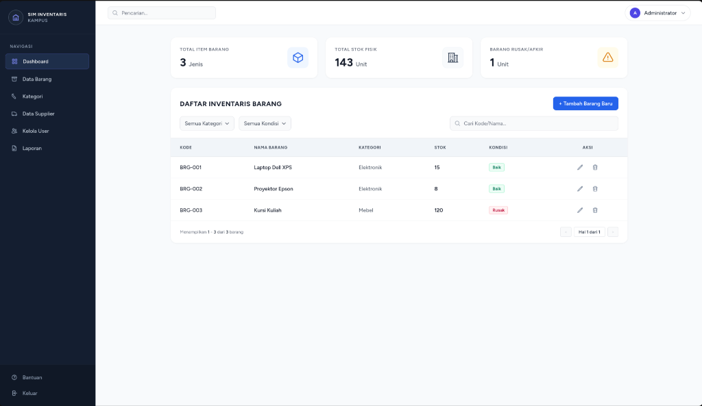
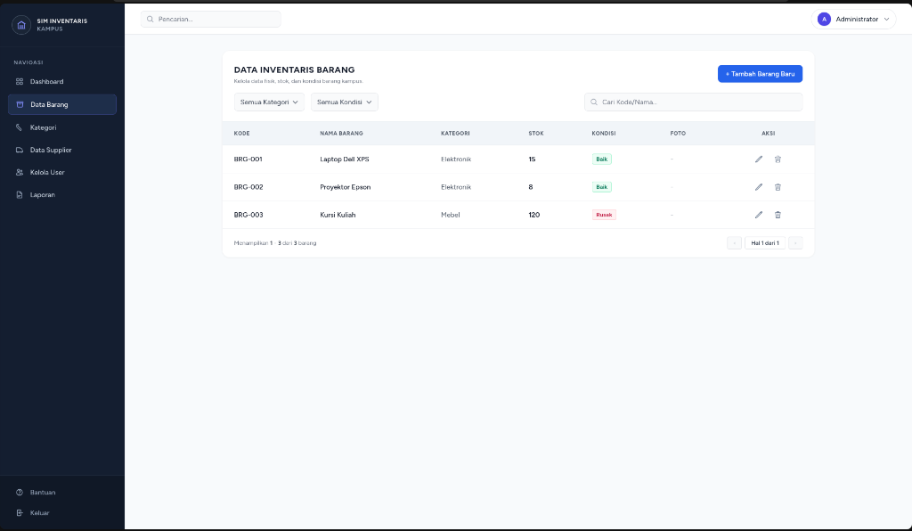
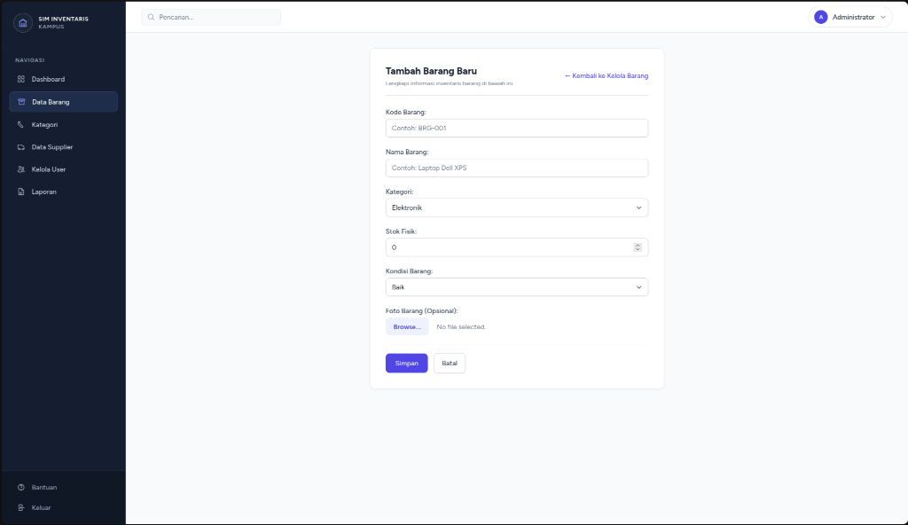
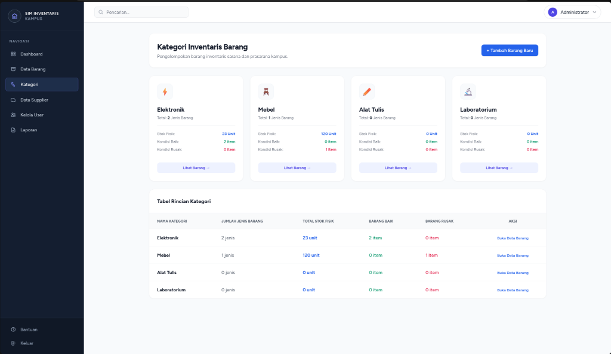
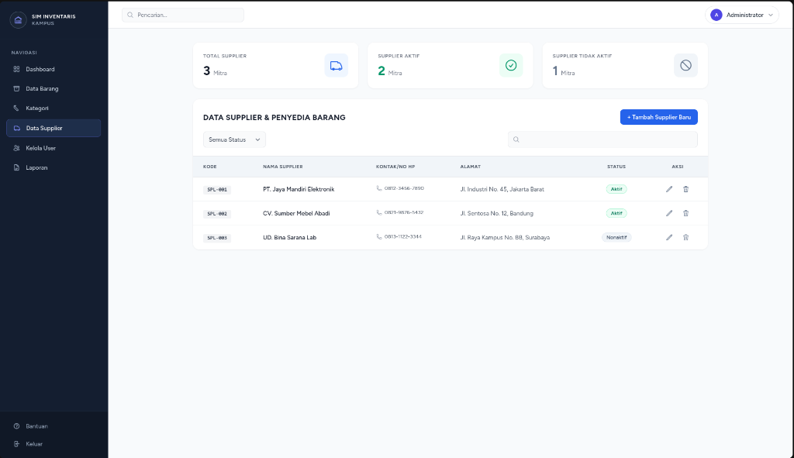
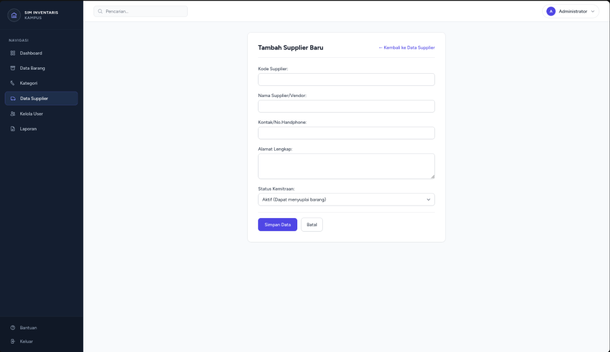
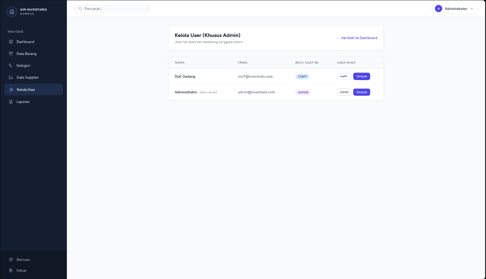
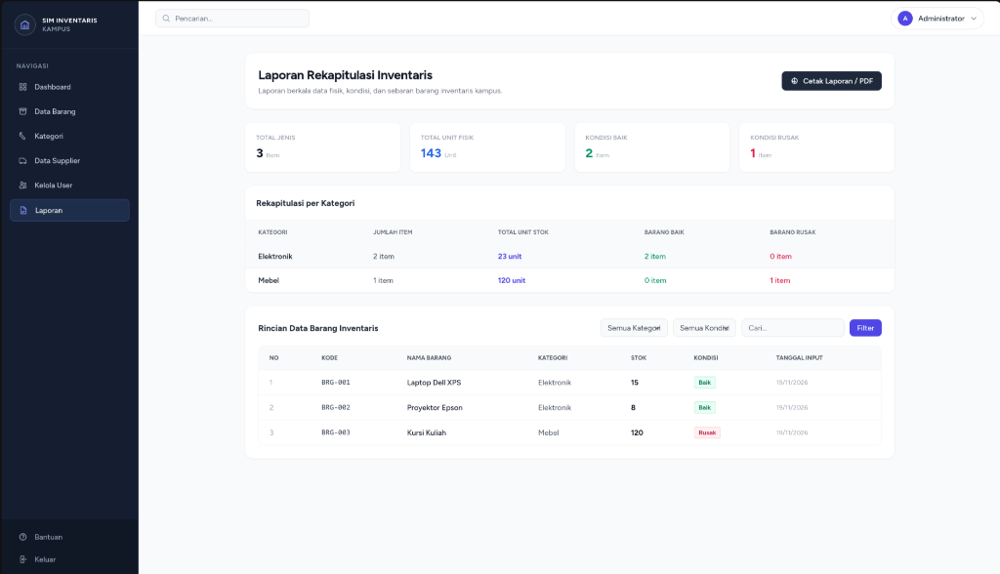

# 📦 SIM INVENTARIS (Sistem Informasi Manajemen Inventaris)

[](https://laravel.com)
[](https://php.net)
[](https://tailwindcss.com)
[](https://alpinejs.dev)
[](https://mysql.com)
[](LICENSE)

Aplikasi web modern berbasis **Laravel 12** dan **Tailwind CSS** untuk pencatatan, pelacakan, dan tata kelola sarana prasarana, aset inventaris fisik, rekanan penyedia (*supplier*), serta penyusunan laporan operasional dan cetak rekapitulasi terpadu.

---

## 👤 Identitas Pengembang

* **Nama:** Zala Risky Pratama
* **NIM:** 2024150064
* **Mata Kuliah:** Pemrograman Web (Semester 5)

---

## 📸 Tangkapan Layar Antarmuka Sistem (Screenshots)

### 1. Dashboard Utama & Metrik Statistik

*Tampilan dashboard utama dengan ringkasan 3 metrik kunci (Total Item Barang, Total Stok Fisik, Barang Rusak/Afkir), live search kode/nama barang, multi-filter kategori dan kondisi, serta tabel inventaris interaktif.*

---

### 2. Manajemen Data Barang & Form Input
| Data Inventaris Barang | Form Tambah Barang Baru |
| :---: | :---: |
|  |  |
| *Tabel katalog barang lengkap dengan status kondisi kelayakan* | *Form input barang terintegrasi dengan upload gambar fisik* |

---

### 3. Kategori Inventaris Barang & Agregasi Otomatis

*Visualisasi kartu kategori (Elektronik, Mebel, Alat Tulis, Laboratorium) dengan agregasi otomatis jumlah unit stok, kondisi baik, dan rusak.*

---

### 4. Manajemen Rekanan (Supplier)
| Data Supplier & Penyedia Barang | Form Tambah Supplier Baru |
| :---: | :---: |
|  |  |
| *Daftar rekanan logistik dengan kartu ringkasan status aktif vs nonaktif* | *Form registrasi supplier lengkap dengan kontak dan alamat kantor* |

---

### 5. Manajemen Pengguna (Khusus Admin) & Laporan Rekapitulasi
| Kelola User & Hak Akses (RBAC) | Laporan Rekapitulasi & Cetak PDF |
| :---: | :---: |
|  |  |
| *Panel administrator untuk mengubah peran (role) staf dan admin* | *Halaman rekapitulasi 4 kuadran & tombol Cetak Laporan PDF resmi* |

---

## ✨ Fitur Utama Sistem

### 1. 📊 Executive Dashboard & Metrik Real-Time
* **3 Kartu Ringkasan Statistik:**
  * `TOTAL ITEM BARANG` (Total variasi/jenis barang terdata).
  * `TOTAL UNIT STOK` (Akumulasi kuantitas stok fisik tersedia).
  * `BARANG RUSAK` (Deteksi dini aset rusak/afkir agar tidak tercampur).
* **Live Search & Multi-Filter:** Pencarian cepat berdasarkan Kode Barang atau Nama Barang, disertai filter kategori dan filter kondisi kelayakan.
* **Tabel Interaktif:** Didukung pagination responsif dan visual status badge.

### 2. 📦 Manajemen Inventaris Barang (CRUD)
* Kode barang unik (`BRG-xxx`) dengan validasi otomatis.
* Pengelompokan kategori barang serta pencatatan stok fisik.
* Status kondisi barang: **Baik** (Emerald) atau **Rusak** (Rose).
* Fitur upload foto/gambar fisik aset inventaris ke storage publik.
* Notifikasi *toast flash message* saat data berhasil dibuat, diperbarui, atau dihapus.

### 3. 🏷️ Kategori Inventaris & Agregasi Otomatis
* Monitoring sebaran aset per kategori: *Elektronik*, *Mebel*, *Alat Tulis*, *Laboratorium*, dll.
* Kalkulasi total jenis, total unit, barang baik, dan barang rusak di setiap kategori secara otomatis via database query aggregation.

### 4. 🚚 Manajemen Data Rekanan (Supplier)
* Pencatatan vendor/supplier penyedia barang (`SPL-xxx`).
* Informasi kontak telepon, alamat operasional, dan status keaktifan rekanan (**Aktif** / **Nonaktif**).
* Statistik kartu mitra aktif vs tidak aktif.

### 5. 📑 Rekapitulasi Laporan & Siap Cetak (Print / PDF)
* Dashboard analitik laporan berkala dengan statistik 4 kuadran.
* Layout khusus siap cetak (*print-friendly* & PDF-ready) lengkap dengan kop surat resmi instansi, meta informasi cetak, dan kolom validasi tanda tangan pengelola inventaris.

### 6. 👥 Kontrol Akses Berjenjang (RBAC: Admin & Staff)
* **Administrator:** Akses penuh seluruh sistem, termasuk menu **Kelola User** untuk mengubah peran (role) staf/admin secara instan.
* **Staf Gudang:** Akses operasional harian (Dashboard, Data Barang, Kategori, Supplier, dan Laporan).
* Keamanan hashing kata sandi menggunakan `Hash::make()` dengan Bcrypt rounds standar industri.

---

## 🛠️ Tech Stack & Kebutuhan Sistem

* **PHP:** Versi 8.2 atau lebih baru
* **PHP Extensions:** `pdo_mysql`, `mbstring`, `openssl`, `tokenizer`, `xml`, `ctype`, `json`, `fileinfo`
* **Composer:** 2.x+
* **Node.js & NPM:** Node.js 18+ & NPM 9+
* **Basis Data:** MySQL 8.x / MariaDB 10.x+ (atau SQLite)
* **Web Server:** Nginx / Apache / PHP Built-in Server

---

## 🚀 Panduan Instalasi & Menjalankan

### 1. Clone Repositori
```bash
git clone https://github.com/nocturnnnnn/sim-inventaris.git
cd sim-inventaris
```

### 2. Pasang Dependensi PHP & Node.js
```bash
composer install
npm install
```

### 3. Konfigurasi Environment (.env)
Salin berkas konfigurasi template:
```bash
cp .env.example .env
```
Buka berkas `.env` dan sesuaikan koneksi database Anda:
```env
DB_CONNECTION=mysql
DB_HOST=127.0.0.1
DB_PORT=3306
DB_DATABASE=sim_inventaris
DB_USERNAME=root
DB_PASSWORD=
# Jika menggunakan socket Unix lokal:
# DB_SOCKET=/tmp/mysql.sock
```

### 4. Generate Kunci Enkripsi & Migrasi Database
```bash
php artisan key:generate
php artisan storage:link
php artisan migrate:fresh --seed
```

### 5. Jalankan Aplikasi
Jalankan kompilasi frontend Vite:
```bash
npm run dev
```

Buka terminal terpisah dan jalankan server lokal Laravel:
```bash
php artisan serve
```
Akses aplikasi melalui browser di: `http://localhost:8000`

---

## 🔑 Akun Default Sistem (Hasil Seeder)

| Peran (Role) | Email Login | Password Default | Akses Menu |
| :--- | :--- | :--- | :--- |
| **Administrator** | `admin@inventaris.com` | `password` | Semua Menu + Manajemen User |
| **Staf Gudang** | `staff@inventaris.com` | `password` | Dashboard, Barang, Supplier, Kategori, Laporan |

---

## 📂 Struktur Direktori Proyek

```
sim-inventaris/
├── app/
│   ├── Http/
│   │   ├── Controllers/
│   │   │   ├── Auth/                     # Autentikasi Laravel Breeze
│   │   │   ├── CategoryController.php    # Agregasi stok kategori
│   │   │   ├── DashboardController.php   # Statistik ringkasan utama
│   │   │   ├── ItemController.php        # CRUD Inventaris Barang & upload foto
│   │   │   ├── ReportController.php      # Laporan & modul cetak PDF
│   │   │   ├── SupplierController.php    # CRUD Supplier & Rekanan
│   │   │   ├── UserController.php        # Manajemen peran pengguna (Admin)
│   │   │   └── ProfileController.php     # Kelola akun & profil
│   │   └── Middleware/
│   │       └── RoleMiddleware.php        # Guard pembatas hak akses peran
│   └── Models/
│       ├── User.php                      # Model pengguna & role
│       ├── Item.php                      # Model inventaris fisik
│       └── Supplier.php                  # Model rekanan penyedia
├── database/
│   ├── migrations/                       # Skema migrasi tabel
│   └── seeders/
│       └── DatabaseSeeder.php            # Seeder akun, barang, & supplier
├── resources/
│   ├── css/ & js/                        # Konfigurasi Tailwind & JavaScript
│   └── views/                            # Blade view templates & components
├── routes/
│   ├── web.php                           # Definisi rute aplikasi & middleware
│   └── auth.php                          # Rute autentikasi
├── screenshots/                          # Tangkapan layar antarmuka aplikasi
└── README.md
```

---

## 📜 Lisensi
Aplikasi ini dikembangkan di bawah lisensi terbuka [MIT](LICENSE).
Hak Cipta (c) 2026 Zala Risky Pratama.
